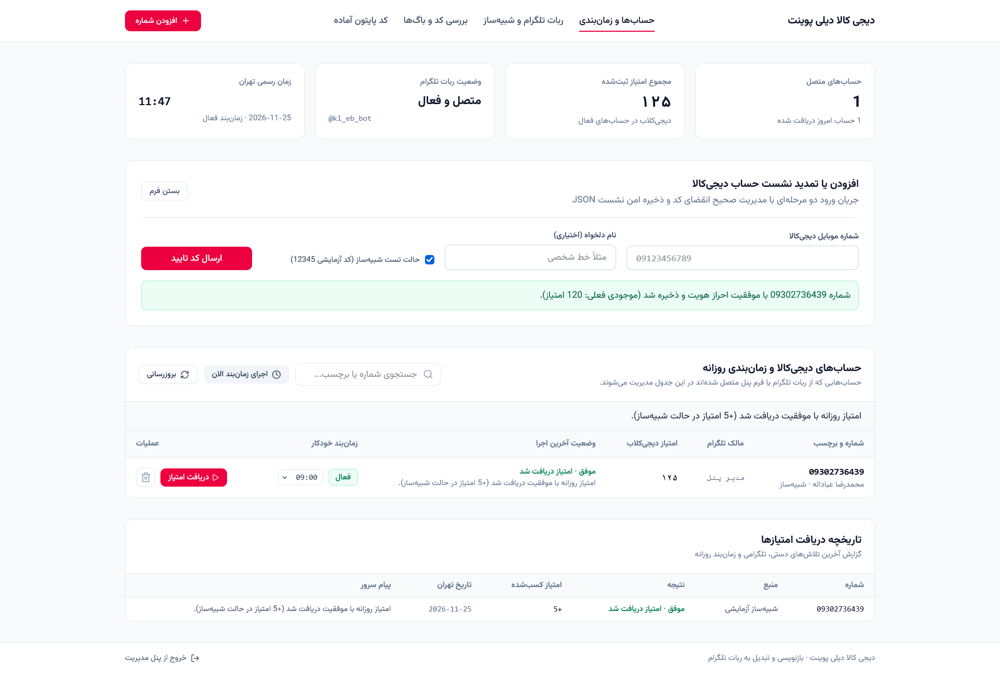
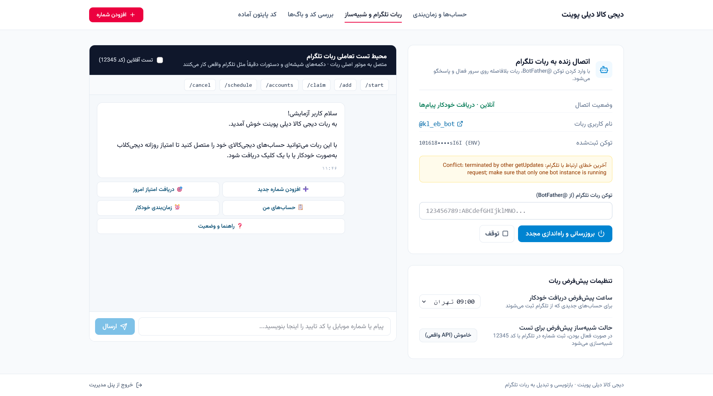
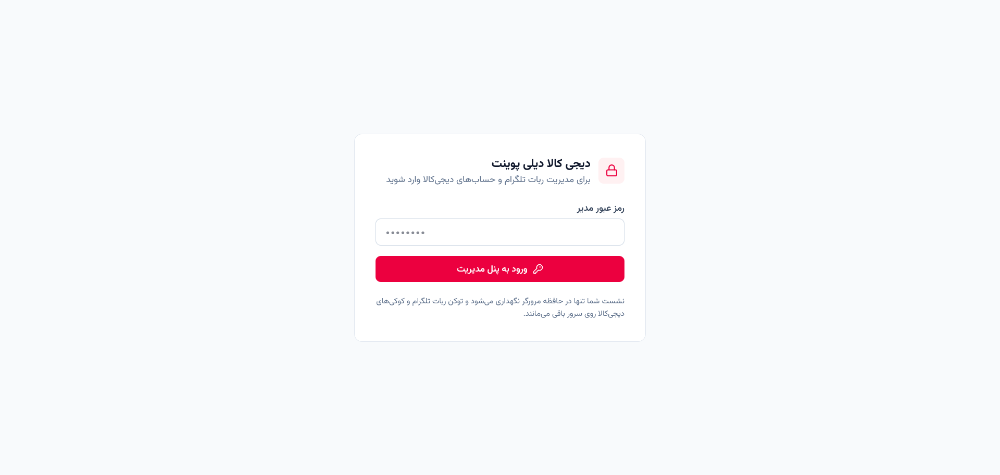
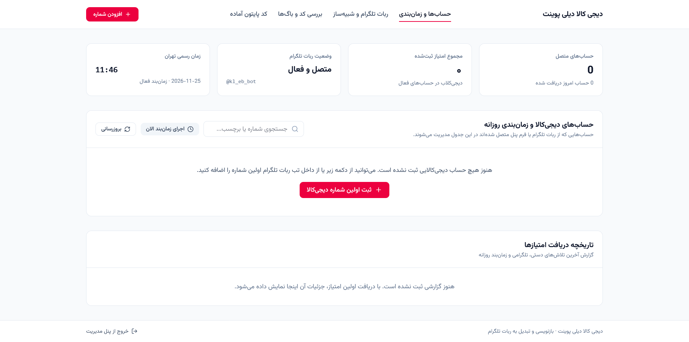
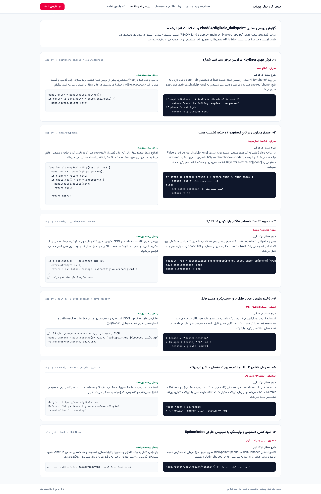
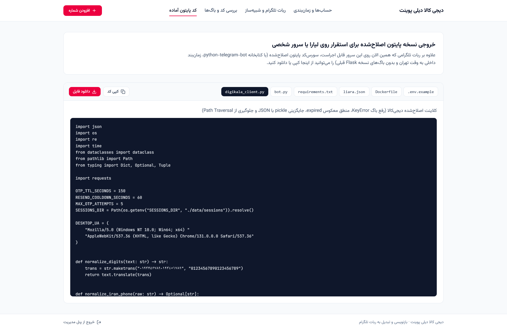

<div dir="rtl">

# دیجی کالا دیلی پوینت (Digikala DailyPoint Bot)

ربات تلگرام هوشمند و پنل مدیریت وب برای **اتصال امن حساب‌های دیجی‌کالا و دریافت خودکار امتیاز روزانه دیجی‌کلاب** به وقت تهران (`Asia/Tehran`).  
این پروژه نسخه بازطراحی‌شده و اشکال‌زدایی‌شده مخزن [`ebad84/digikala_dailypoint`](https://github.com/ebad84/digikala_dailypoint) است.

---

## امکانات فعلی (چیا هست؟)

- **ربات تلگرام چندکاربره با منوی شیشه‌ای فارسی:** هر کاربر از طریق `/start`، `/add`، `/claim`، `/accounts` و `/schedule` فقط حساب‌های متعلق به `chat_id` خودش را مدیریت می‌کند.
- **اصلاح کامل چرخه OTP و سشن دیجی‌کالا:** رفع باگ `KeyError`، اصلاح منطق معکوس انقضای کد (`150` ثانیه + محدودیت ارسال مجدد و حداکثر ۵ تلاش)، بررسی `status === 200` پیش از ذخیره سشن، نرمال‌سازی ارقام فارسی و فرمت `09xxxxxxxxx`.
- **ذخیره‌سازی امن JSON به جای `pickle`:** حذف ریسک `pickle` و آسیب‌پذیری مسیر فایل (`Path Traversal`) و جایگزینی با ذخیره‌سازی اتمی روی دیسک (`./data/dailypoint-db.json`).
- **زمان‌بند خودکار روزانه (ساعت تهران):** بدون نیاز به UptimeRobot؛ دریافت خودکار امتیاز در ساعت انتخابی کاربر و ارسال گزارش در تلگرام.
- **پنل مدیریت وب + شبیه‌ساز تعاملی ربات:** داشبورد محافظت‌شده با رمز ادمین (`scrypt` + توکن `Bearer`)، مدیریت حساب‌ها، تاریخچه دریافت امتیاز و محیط تست زنده ربات در مرورگر.
- **خروجی کد پایتون آماده (`python-telegram-bot`):** قابل مشاهده و دانلود از تب «کد پایتون آماده» برای اجرای سبک روی لیارا یا VPS.

---

## تصاویر محیط برنامه (Screenshots)

| داشبورد مدیریت حساب‌ها و دریافت امتیاز | اتصال زنده به ربات تلگرام و شبیه‌ساز |
| :---: | :---: |
|  |  |

| صفحه ورود امن مدیر | حالت اولیه داشبورد |
| :---: | :---: |
|  |  |

| بررسی کد و باگ‌های مخزن قبلی | خروجی کد پایتون آماده استقرار |
| :---: | :---: |
|  |  |

---

## متغیرهای محیطی (`.env`)

پیش از اجرا یا دیپلوی، مقادیر زیر را در `.env` یا بخش **Environment / Secrets** سرویس میزبان تنظیم کنید:

</div>

```env
# توکن ربات تلگرام دریافتی از @BotFather
TELEGRAM_BOT_TOKEN=123456789:ABCdef...

# رمز عبور پنل مدیریت وب (در صورت خالی بودن، در اولین ورود فرم ساخت رمز نمایش داده می‌شود)
ADMIN_PASSCODE=your_strong_passcode

# کلید امضای نشست‌های پنل مدیریت (اختیاری - در صورت نبود به صورت تصادفی در حافظه ساخته می‌شود)
SESSION_SECRET=your_random_32_byte_hex_secret

# پورت اجرای سرور (پیش‌فرض 3000)
PORT=3000
```

<div dir="rtl">

---

## راه‌های دیپلوی و اجرا

> **نکته بسیار مهم برای تلگرام:** از یک `TELEGRAM_BOT_TOKEN` هم‌زمان فقط روی **یک** سرور/نمونه با حالت `getUpdates` (Polling) استفاده کنید؛ در غیر این صورت خطای زیر را دریافت می‌کنید:
> `Conflict: terminated by other getUpdates request; make sure that only one bot instance is running`

### ۱. اجرا روی سیستم شخصی (توسعه و تست)

</div>

```bash
git clone https://github.com/ebad84/digikala_dailypoint.git
cd digikala_dailypoint

npm install
cp .env.example .env
# توکن TELEGRAM_BOT_TOKEN را در فایل .env وارد کنید

npm run dev
# پنل وب روی http://localhost:3000 بالا می‌آید و ربات تلگرام هم‌زمان فعال می‌شود
```

---

<div dir="rtl">

### ۲. دیپلوی روی لیارا (Liara)

بسته به اینکه می‌خواهید **نسخه کامل (پنل وب + ربات Node.js)** را بالا بیاورید یا فقط **نسخه سبک پایتون** را، یکی از دو مسیر زیر را انجام دهید:

#### الف) دیپلوی نسخه کامل (Node.js + پنل وب + ربات تلگرام)
1. در پنل لیارا یک برنامه جدید با پلتفرم **Node.js** بسازید.
2. در بخش **دیسک‌ها (Disks)** یک دیسک جدید (مثلاً `data-disk`) بسازید و به مسیر `/usr/src/app/data` (یا مسیر `./data` پروژه) مانت کنید تا سشن‌ها با ری‌استارت پاک نشوند.
3. در بخش **متغیرهای محیطی (Environment)** متغیرهای `TELEGRAM_BOT_TOKEN`، `ADMIN_PASSCODE` و `SESSION_SECRET` را اضافه کنید.
4. با Liara CLI پروژه را دیپلوی کنید:

</div>

```bash
npm install -g @liara/cli
liara login
liara deploy --port 3000
```

<div dir="rtl">

#### ب) دیپلوی نسخه پایتون خالص (بدون پنل وب، مصرف رم بسیار کم)
فایل‌های تب **«کد پایتون آماده»** در پنل را در یک پوشه ذخیره کنید (`bot.py`، `digikala_client.py`، `requirements.txt`، `Dockerfile`، `liara.json`) و در پنل لیارا یک برنامه **Docker** بسازید (فایل `liara.json` به‌صورت خودکار دیسک `/app/data` را تعریف می‌کند):

</div>

```bash
# تنظیم متغیر TELEGRAM_BOT_TOKEN در پنل لیارا و سپس:
liara deploy --platform docker
```

---

<div dir="rtl">

### ۳. دیپلوی روی سرور شخصی (Ubuntu VPS با PM2 یا Docker)

#### روش الف: اجرا با Node.js و PM2

</div>

```bash
# ۱. نصب Node.js 22 و PM2 روی سرور
curl -fsSL https://deb.nodesource.com/setup_22.x | sudo -E bash -
sudo apt-get install -y nodejs
sudo npm install -g pm2

# ۲. دریافت پروژه و بیلد نسخه نهایی
git clone https://github.com/ebad84/digikala_dailypoint.git
cd digikala_dailypoint
npm install
npm run build

# ۳. ساخت فایل .env و اجرا با PM2
cp .env.example .env
nano .env  # مقادیر TELEGRAM_BOT_TOKEN و ADMIN_PASSCODE را وارد کنید

NODE_ENV=production pm2 start "npm start" --name digikala-dailypoint
pm2 save
pm2 startup
```

<div dir="rtl">

*(توصیه می‌شود روی VPS از Nginx به عنوان Reverse Proxy با گواهی SSL روی پورت 3000 استفاده کنید.)*

#### روش ب: اجرا با Docker روی سرور لینوکس

</div>

```bash
docker build -t digikala-dailypoint-bot .
docker run -d \
  --name digikala-bot \
  --restart unless-stopped \
  -e TELEGRAM_BOT_TOKEN="YOUR_BOT_TOKEN" \
  -v $(pwd)/data:/app/data \
  digikala-dailypoint-bot
```

---

<div dir="rtl">

## وضعیت پروژه و TODO (چیا هست / چیا نیست و باید کامل شه)

### ✅ انجام‌شده (در پروژه موجود است)
- [x] رفع کرش `KeyError` و منطق معکوس `expired()` در ثبت OTP دیجی‌کالا
- [x] حذف `pickle` و ذخیره امن کوکی‌ها با JSON + جلوگیری از Path Traversal
- [x] ربات تلگرام کامل (`/start`, `/add`, `/claim`, `/accounts`, `/schedule`, `/help`) با ایزوله‌سازی هر کاربر
- [x] زمان‌بند داخلی روزانه به وقت تهران + اطلاع‌رسانی خودکار تلگرامی
- [x] پنل مدیریت وب فارسی (RTL) با احراز هویت مدیر (`scrypt` + `Bearer Token`)
- [x] شبیه‌ساز تعاملی ربات تلگرام + حالت تست آفلاین (Sandbox)
- [x] خروجی فایل‌های پایتون اصلاح‌شده برای لیارا و داکر
- [x] فاوایکون اختصاصی (`favicon.ico`) و متادیتای کامل پروژه

### 🚧 در دست توسعه (چیا فعلاً نیست و برای نسخه‌های بعدی پیشنهاد می‌شود)
- [ ] پشتیبانی از سایر ماموریت‌های روزانه و هفتگی دیجی‌کلاب (فراتر از `mission_id: 1`)
- [ ] پشتیبانی از **Telegram Webhook** در کنار Long-Polling (جلوگیری کامل از خطای Conflict در محیط‌های چندنمونه‌ای)
- [ ] گزارش‌گیر نموداری امتیازهای ماهانه و خروجی Excel/CSV در پنل مدیریت
- [ ] هشدار خودکار در تلگرام هنگام منقضی شدن کوکی سشن (خطای `401`) همراه با دکمه تمدید سریع
- [ ] پشتیبانی از پروکسی/IP ایران برای سرورهای خارجی که ممکن است توسط فایروال دیجی‌کالا محدود شوند

---

### ☁️ TODO ویژه: استقرار روی Cloudflare Workers (جای خالی برای تکمیل)

> **وضعیت:** `در انتظار تکمیل` — برای انتقال کامل ربات از سرور دائمی (VPS/Liara) به **Cloudflare Workers (سرورلس و رایگان)**، موارد زیر باید پیاده‌سازی و جایگزین شوند:

- [ ] **۱. فایل تنظیمات `wrangler.toml`:** تعریف ورودی Worker، بایندینگ دیتابیس و Cron Trigger.
- [ ] **۲. جایگزینی ذخیره فایلی (`fs` / `dailypoint-db.json`) با Cloudflare D1 یا KV:** چون Workers سیستم فایل ماندگار ندارد، حساب‌ها و کوکی‌ها باید در **KV Namespace** یا **D1 (SQLite)** ذخیره شوند.
- [ ] **۳. تبدیل Polling به Telegram Webhook:** به جای حلقه `getUpdates`، یک روت `POST /api/telegram/webhook` در Worker پیاده‌سازی و با متد `setWebhook` به تلگرام معرفی شود.
- [ ] **۴. جایگزینی `setInterval` با Cron Triggers:** استفاده از هندلر `scheduled(event, env, ctx)` در Cloudflare Workers برای اجرای خودکار روزانه در ساعت `09:00` تهران (`05:30 UTC`).
- [ ] **۵. تنظیم Secrets در Cloudflare:** ثبت `TELEGRAM_BOT_TOKEN` و `ADMIN_PASSCODE` از طریق `wrangler secret put`.

<!-- جای خالی مشخصات دیپلوی Cloudflare Workers (پس از تکمیل پر شود) -->
```toml
# TODO: تکمیل wrangler.toml برای دیپلوی روی Cloudflare Workers
# name = "digikala-dailypoint-bot"
# main = "src/worker.ts"
# compatibility_date = "2026-01-01"
#
# [triggers]
# crons = ["30 5 * * *"] # 09:00 AM Asia/Tehran
#
# [[kv_namespaces]]
# binding = "DAILYPONT_KV"
# id = "YOUR_KV_NAMESPACE_ID"
```

```text
# جای خالی لینک و اطلاعات پس از دیپلوی روی Cloudflare Workers:
# Worker URL:       https://________________________________.workers.dev
# Webhook Endpoint: https://________________________________.workers.dev/api/telegram/webhook
# KV / D1 Binding:  ________________________________________
# Cron Schedule:    ________________________________________
```

</div>
